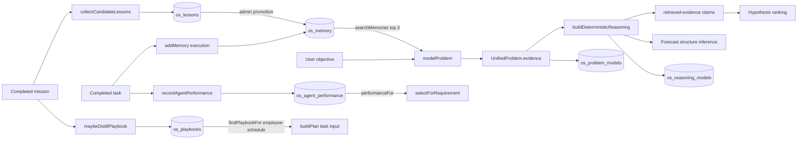
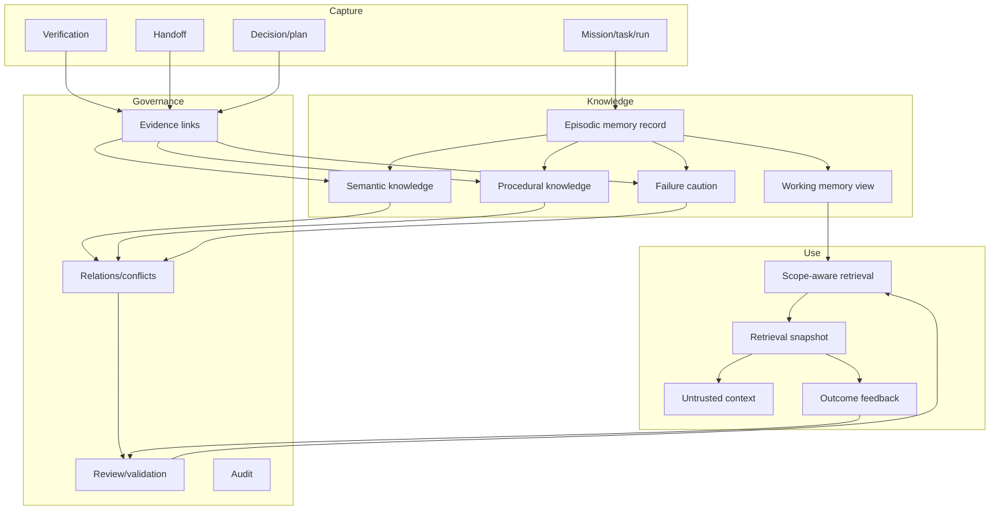
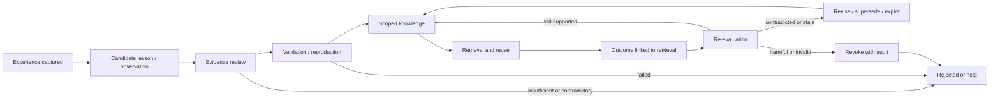

# WORA Phase 8 Stage 1 — Knowledge & Memory Evolution Audit and Architecture

**Status:** audit and architecture only. No Phase 8 feature, production code, migration or dependency was added.
**Repository:** `momenmaaly/wora-agent-os`
**Branch:** `feat/extensions-subsystem`
**HEAD at audit:** `834ba38` (`fix(os): generalize forecast intent and input readiness`)
**Working tree before and after this audit:** clean
**Audit date:** 2026-11-23

---

## 0. Executive summary

WORA already has a small, real, workspace-scoped memory substrate:

- free-text records with scope, provenance, owner/workspace visibility and TTL;
- deterministic lexical retrieval;
- version snapshots on create and delete;
- a candidate-lesson workflow that can be evaluated, promoted into semantic memory, rejected and revoked;
- validated operational-research playbooks;
- verified agent-performance learning used by dynamic selection;
- persisted mission, plan, reasoning, verification and handoff records.

Those are useful foundations. They are **not** a reliable knowledge-evolution system.

The central finding is that WORA currently has several different learning paths with different trust models, but no single knowledge model that carries evidence, conditions, validity, contradiction state, review state and reuse outcomes end to end.

The most important verified findings are:

1. **Memory retrieval is real but weakly bounded.** `modelProblem` retrieves up to three records and places them in `UnifiedProblem.evidence`; the reasoning engine converts them into low-trust `retrieved-evidence` claims and can use them in hypotheses and forecast-structure inference. The plan itself is mostly built from the objective, so memory currently influences reasoning metadata more than executable decisions.
2. **Most memory is not actually consumed by the planner.** Retrieval is not wired into scientific method selection, composition, agent selection, execution, verification or replanning. Operational-research playbooks are the one exception where stored experience changes a plan.
3. **Scope is a label, not an authorization model.** The scope column accepts eight values, but retrieval does not enforce project, agent, organization, user or mission visibility. Mission retrieval does not pass the actor at all.
4. **Owner visibility is not reliable.** `GET /memory/:id/versions` does not apply the actor ACL, and `modelProblem` calls retrieval with the default actor `'user'`. A direct probe showed an owner-only record's version content returned to a different actor, and mission retrieval included an owner-only record owned by `user`.
5. **Unverified content can bypass the lesson lifecycle.** Any member can `POST /memory` with `scope: "semantic"`, arbitrary content, tags such as `verified`, and no evidence. The lesson promotion workflow is therefore not a mandatory trust gate.
6. **Failure learning is largely absent.** Candidate lessons are collected only for completed missions. Failures are classified for retry/replacement, but they are not turned into structured, scoped failure knowledge. A failed mission produces no lesson or memory.
7. **Lesson effectiveness is caller-asserted.** `POST /lessons/:id/outcomes` accepts a boolean and optional free-form evidence; it does not re-check a verification record, outcome or mission ownership. It is member-level, not admin-level.
8. **Sensitive content is not uniformly protected.** `addMemory` stores raw content; the memory API returns it without redaction; lesson content is built from task objectives without redaction; playbooks move decrypted task tool inputs into a plaintext JSON column; memory versions survive deletion.
9. **The advertised `memory.search`/`memory.write` tools do not exist in the tool registry.** Specializations advertise them, and the System Console tells users agents retrieve memory through `memory.search`, but the registry has 22 tools and neither ID is present.
10. **No comparative memory evaluation exists.** The existing Phase 6 evaluation explicitly uses `includeMemory: false`; the benchmark suite has no memory fixture. No claim that memory improves reasoning is supported today.

The recommended direction is not four databases. It is one memory substrate with typed knowledge records, explicit evidence links, scope-aware access, retrieval snapshots and a stricter promotion lifecycle. Existing tables, lesson workflow, playbooks, verification records, capability snapshots and skill-context patterns should be extended rather than duplicated.

---

## 1. Repository and safety verification

### 1.1 Repository state

Verified with `git rev-parse --short HEAD`, `git branch --show-current`, `git status --short` and `git log --oneline -8`:

```text
834ba38
feat/extensions-subsystem
(clean worktree)
834ba38 fix(os): generalize forecast intent and input readiness
1586bb4 feat(os): add evidence-grounded reasoning and problem intelligence
e91540b feat(os): verify mission outcomes and harden capability fallbacks
d544814 Add unified problem model and capability composition
...
```

The expected starting commit `834ba38` matches. No rebase, reset, delete, push, merge or deploy was performed.

### 1.2 Baseline commands run

These are repository evidence, not proposed results:

| Check | Result |
| --- | --- |
| API typecheck (`npm run typecheck`) | exit 0 |
| Client typecheck (`npm run typecheck`) | exit 0 |
| Full API suite (`npm test`) | 343 tests, 342 passed, 1 skipped (MongoDB opt-in), 0 failed |
| Client suite (`npm test`) | 50 passed, 0 failed |
| Targeted lessons/security/selection suites | 26 passed, 0 failed |
| Memory-specific tests in `os.test.ts` | 3 passed, 0 failed |
| Actual tool-registry probe | `memory.search=false`, `memory.write=false`, 22 registered tools |
| Owner-version ACL probe | content returned to a different actor (finding, not a pass) |

The full API count includes unrelated subsystems. It is not evidence that memory is reliable; the memory-specific coverage is small and is listed in §2.7.

### 1.3 Scope of this audit

Inspected at minimum:

- `api-server/src/os/memory.ts`
- `api-server/src/os/lessons.ts`
- `api-server/src/os/playbooks.ts`
- `api-server/src/os/orchestrator.ts`
- `api-server/src/os/problem-model.ts`
- `api-server/src/os/problem-structure.ts`
- `api-server/src/os/reasoning-engine.ts`
- `api-server/src/os/reasoning-store.ts`
- `api-server/src/os/selection.ts`
- `api-server/src/os/capability-composition.ts`
- `api-server/src/os/verification.ts`
- `api-server/src/os/adaptive-replan.ts`
- `api-server/src/os/router.ts`
- `api-server/src/os/db.ts`
- `api-server/src/os/migrations.ts`
- `api-server/src/os/security-adversarial.test.ts`
- `api-server/src/os/lessons.test.ts`
- `api-server/src/os/os.test.ts`
- `api-server/src/os/selection.test.ts`
- `api-server/src/os/selection-benchmark.test.ts`
- `api-server/src/extensions/capabilities.ts`
- `api-server/src/extensions/schema.ts`
- `api-server/src/extensions/skill-intelligence.ts`
- `api-server/src/extensions/store.ts`
- `client/src/components/SystemConsole.tsx`
- `client/src/components/IntelligenceHub.tsx`
- `docs/WORA_EXPERIENCE_LEARNING.md`
- `docs/WORA_LESSON_LIFECYCLE.md`
- `docs/WORA_SCIENTIFIC_EXECUTION.md`
- `docs/WORA_PROGRESS.md`

Documentation drift was also found:

- `docs/WORA_PROGRESS.md` records `HEAD at audit: 321d69b`, not the actual `834ba38`.
- `docs/WORA_EXPERIENCE_LEARNING.md` says lesson revocation does not exist; it does.
- `docs/WORA_IMPLEMENTATION_ROADMAP.md` says monitoring and revocation remain; revocation is implemented, monitoring is not.
- `docs/WORA_PROGRESS.md` still lists the learning lifecycle as incomplete in §3 even though a later section describes the first slice.

These are documentation defects, not runtime behavior. They increase the risk that future work assumes capabilities that are absent or misses capabilities that exist.

---

## 2. Existing memory architecture audit

### 2.1 Memory storage

#### 2.1.1 Tables and fields

| Table | Source | Fields | Actual role |
| --- | --- | --- | --- |
| `os_memory` | baseline DDL in `os/db.ts`, plus guarded `ALTER TABLE` in `db.ts` | `id`, `workspace_id`, `scope`, `scope_id`, `content`, `tags`, `provenance`, `agent_id`, `created_at`, `updated_at`, `visibility`, `owner_id`, `expires_at` | Free-text memory and the destination for promoted lessons |
| `os_memory_versions` | baseline DDL | `id`, `memory_id`, `workspace_id`, `scope`, `content`, `tags`, `action`, `actor`, `created_at` | Create/delete snapshots, capped at 20 per memory |
| `os_lessons` | baseline DDL | mission/task IDs, title, content, evidence JSON, status, confidence, version, provenance, creator, promotion/revocation fields, outcome counters | Candidate/promoted lesson workflow |
| `os_lesson_events` | baseline DDL | lesson ID, action, actor, detail, timestamp | Lesson history |
| `os_playbooks` | baseline DDL | tool ID, keywords, tool input JSON, validation JSON, success/reuse counters, source mission | Validated OR procedure |
| `os_agent_performance` | baseline DDL, migration 5 | workspace/agent/category, attempts, verified successes/failures, duration, last failure | Agent-selection learning |
| `os_verifications` | baseline DDL, migration 10 additions | objective, acceptance, expected/actual output, evidence, checks, result, independence, verifier | Evidence source for lessons and performance |
| `os_runs`, `os_tasks`, `os_missions`, `os_handoffs`, `os_artifacts`, `os_decision_records`, `os_plan_versions`, `os_reasoning_models`, `os_problem_models`, `os_task_checkpoints` | baseline / migrations | Execution, evidence, plans, decisions, checkpoints | Episodic raw state, not retrieved as memory |

The runtime `PRAGMA table_info` check confirmed the columns:

```text
os_memory        id,workspace_id,scope,scope_id,content,tags,provenance,agent_id,created_at,updated_at,visibility,owner_id,expires_at
os_memory_versions id,memory_id,workspace_id,scope,content,tags,action,actor,created_at
os_lessons       ...evidence,status,confidence,version,provenance,created_by,promoted_by,promoted_at,memory_id,revoked_by,revoked_at,revocation_reason,outcome_count,success_count,effectiveness,...
os_playbooks     ...tool_input,validation,status,success_runs,created_from_mission,...,reuse_count
os_agent_performance ...attempts,verified_successes,verified_failures,total_duration_ms,last_failure_at,...
```

#### 2.1.2 Scoping and isolation

- Every SQL query is filtered by `workspace_id`.
- `workspace_id` is resolved per session in `router.ts`; in production the workspace is derived from the signed-in user (`wora-${userId}`), while the admin API can select a workspace with `x-workspace`.
- `os_memory.scope` accepts `user`, `workspace`, `project`, `agent`, `organization`, `execution`, `episodic`, `semantic`. This is a naming taxonomy, not an authorization model.
- `visibility` has only two values: `workspace` and `owner`.
- `scope_id` is a free-form string with no foreign key. No project, organization or agent membership is consulted.
- Lessons and playbooks are workspace-wide only. `os_lessons` and `os_playbooks` have no scope, scope ID or visibility column.
- There is no cross-workspace sharing table or organization-level store. The extension subsystem has `instance`, `organization`, `project`, `agent`, `user` scopes, but those are installation scopes and are not reused by memory.

#### 2.1.3 Persistence and lifecycle

- `addMemory` inserts content (maximum 20,000 characters), tags (maximum 20), provenance string, optional agent, visibility and TTL. TTL is clamped to 3,650 days.
- `getMemory` and list/search hide rows when `expires_at <= now`.
- There is **no background purge** and no database-level retention job. Expired rows remain and their versions remain readable.
- `deleteMemory` snapshots a `delete` version, deletes the row and writes an audit event.
- There is no update function, no restore function, no soft-delete tombstone, no cascade from memory to versions, and no `ON DELETE` behavior for versions.
- `listMemoryVersions` reads versions by `workspace_id` and `memory_id` but does not check visibility, expiry, ownership or whether the parent memory still exists.

#### 2.1.4 Versioning

- A version snapshot is written on `create` and `delete` only.
- `VERSION_CAP = 20`; older snapshots are deleted.
- Versions store content/tags/action/actor but not visibility, provenance, scope ID, TTL, evidence, confidence, validation or relationships.
- `os_lessons.version` increments only on promotion. It is not a content-revision version.
- `os_playbooks` has no version column. `os_agent_performance` has one current row per agent/category, no history.

#### 2.1.5 Migration state

- `os_memory`, `os_memory_versions`, `os_lessons`, `os_lesson_events`, `os_playbooks` and `os_agent_performance` are created in the baseline schema or migration 5.
- `visibility`, `owner_id`, `expires_at` on `os_memory` are added by a **guarded, non-versioned** `migrate()` function in `db.ts`.
- `os_lessons` promotion/revocation/outcome columns are also added by guarded, non-versioned `ALTER TABLE` statements.
- Versioned migrations 1–12 contain no memory knowledge-model migration. The extension subsystem owns its own schema and its own `ensureExtensionSchema` path.
- This contradicts the repository's versioned-migration direction and makes a future memory migration harder to reason about. It is an architectural issue, not only a documentation issue.

### 2.2 Memory creation

#### 2.2.1 Creation paths

| Path | Trigger | Content | Evidence required | Automatic? |
| --- | --- | --- | --- | --- |
| `POST /memory` | Member action | Raw user text | No | No |
| `POST /api/os/memory` route | Same | Raw user text; provenance forced to `'user'` | No | No |
| Completed task | `executeMission` after a passed review | `Task "<title>" completed by <agent>. <deliverables>` redacted | The task review and independent checks passed, but the memory row does not link to them | Yes, automatically |
| `promoteLesson` | Admin action after evaluation | Lesson content | Evaluation checked an existing passed verification; promotion does not add a structured evidence link to the memory row | No |
| `collectCandidateLessons` | Completed mission, `afterMission` | Task objective, tool and verification ID/digest | Passed acceptance-review and artifact-integrity checks | Yes, candidates only |
| `maybeDistillPlaybook` | Any finalized mission with completed OR tasks | Tool and exact input, re-solved | Revalidation of the input | Yes, for OR tasks |
| `recordAgentPerformance` | Task completion | Category counters | Review + independent check passed | Yes |
| Failure | No automatic memory path | Failure recorded in runs/verifications/handoffs/decisions | No lesson/memory is created | No |

#### 2.2.2 Answers to the audit questions

- **Are successful missions remembered?** Partially. Each completed task writes an execution memory. Candidate lessons are collected for completed missions, but only from eligible verification records.
- **Are failed missions remembered?** Not as memory or lessons. The failure survives in `os_runs`, `os_verifications`, `os_handoffs` and decision records. It is not retrievable as a lesson.
- **Is creation automatic or manual?** Both. Manual API writes and automatic execution/lesson/playbook/performance writes exist.
- **Is evidence required before saving?** Only for lesson promotion and playbooks. Manual semantic memory requires no evidence; execution memory does not store its verification ID in the row.
- **Are duplicates detected?** Lessons check for an existing lesson by mission/task before insertion, but there is no unique constraint, so concurrency can duplicate. Playbooks use token Jaccard ≥ 0.5 for a "twin". Memory has no duplicate detection.
- **Are contradictions detected at write time?** No. The reasoning layer has a lexical contradiction detector over claims, but it does not update memory, mark either record, or prevent promotion.

#### 2.2.3 Concrete trust bypass

`POST /memory` is member-level and accepts:

```text
scope: semantic
content: arbitrary text
tags: ["verified", ...]
provenance: "user" (forced)
```

No verification ID, evidence, reviewer or validation is required. A user can therefore place an unverified statement into the same `scope=semantic` namespace used by promoted lessons, with a tag that looks verified. The lesson workflow is not a mandatory gate for semantic memory.

### 2.3 Memory retrieval

#### 2.3.1 Algorithm

`searchMemories(workspaceId, query, { scope?, limit?, actor? })`:

1. Tokenizes query and candidate text with Unicode letter/number matching, discarding tokens of length 1.
2. Reads candidates through `listMemories`, capped at 500 newest records, newest first.
3. Merges content and tags into a bag of tokens.
4. Computes term frequency and inverse document frequency over that candidate set:
   - `idf = log(1 + n / documentFrequency(term))`.
   - Score is the sum of term frequency × IDF.
5. Filters score > 0, sorts descending, returns up to 50 (default 10).
6. Applies the workspace filter in SQL and the owner-visibility filter after candidate loading.

This is a deterministic TF-IDF-like lexical ranker. It is not BM25, not phrase-aware, not field-weighted, not semantic and not embedding-based.

#### 2.3.2 Scope and ACL behavior

- `listMemories` can filter by `scope` and optionally `scopeId`, but the HTTP API exposes only `scope`, `q` and `limit`; it does not expose `scopeId`.
- `searchMemories` accepts `scope` only. It cannot restrict to a project, agent, organization or execution.
- `canSee` checks only `visibility = 'owner'` and `owner_id === actor`.
- `modelProblem` calls `searchMemories(input.workspaceId, objective, { limit: 3 })` without an actor. The default is `'user'`.
- Therefore owner-only records owned by the literal actor `'user'` can enter a mission's evidence. The retrieval service has an ACL, but the mission call site does not use it correctly.
- `listMemoryVersions` ignores `actor` entirely. This is a confirmed content leak if the memory ID is known. IDs appear in the memory list and audit records.
- Lessons and playbooks are workspace-wide; no actor ACL at all.

#### 2.3.3 Ranking and context selection

- No relevance threshold, no score floor, no tie-breaking policy beyond score order.
- No reliability, verification, trust, freshness, recency, source diversity or failure-history factor.
- No token budget. `modelProblem` hard-codes 3 records and truncates each statement to 500 characters.
- No query expansion, synonym handling, stemming, Arabic morphological handling or phrase matching.
- No candidate partitioning by scope or knowledge type.
- No retrieval provenance table. The persisted `UnifiedProblem.provenance` only says `memory:retrieved`; the evidence entries contain `memoryId`, source, statement and score. The later reasoning model can be persisted, but the retrieval candidate set, omitted records and scoring reasons are not recorded.
- `modelProblem` catches retrieval errors silently. A database failure and "no relevant knowledge" are indistinguishable.

#### 2.3.4 Retrieval tests

`os.test.ts` has three memory tests:

- workspace isolation on write/search/list/delete;
- owner visibility filtering in list/search and delete;
- create/delete versions and TTL on list.

There is **no test** for:

- retrieval inside `modelProblem`;
- actor propagation into mission retrieval;
- version ACL;
- scope ID isolation;
- ranking quality;
- contradictions;
- stale records;
- retrieval token budget;
- retrieval influence on a plan;
- retrieval provenance;
- owner-only lesson/playbook content.

### 2.4 Memory consumption

#### 2.4.1 Actual data flow



#### 2.4.2 Where memory actually changes behavior

| Stage | Actual influence | Assessment |
| --- | --- | --- |
| Problem understanding | `understandProblem` itself runs on the objective before memory. `inferProblemStructure` also receives retrieved memory statements and can use them for target, horizon, projection and series signals. | Implemented, insufficiently verified; risky because old memory can look like observed input. |
| Claim extraction | `initialClaims` adds each `base.evidence` entry as a `retrieved-evidence` claim with trust `unverified` and confidence 0.35. | Implemented, verified only by source inspection; no retrieval test. |
| Hypothesis generation | Retrieved claims are included in the clause set used for lexical hypothesis scoring. | Implemented, insufficiently verified; memory can shift ranking. |
| Scientific method selection | `methodAssessments` uses `problemType`, objective and base profile. It does not read `base.evidence`. | No direct memory influence. |
| Planning | `buildPlan` uses the objective text and explicit branches. `composeMissionPlan` uses `model.needs` and the algorithm-selection profile, not memory evidence. | No direct general-memory influence. Playbooks are the exception. |
| Agent selection | `selection.ts` uses `os_agent_performance` and verification history, not general memory. | Real learning influence, but separate from semantic memory. |
| Capability composition | Uses model needs and algorithm selection; not memory evidence. | No direct memory influence. |
| Execution | Skill context is injected if extensions provide it; general memory is not. | No general memory influence. |
| Verification | Uses run output, acceptance, deterministic checks and independent checks; no memory. | No memory influence. |
| Replanning | Uses failure evidence, decision records and adaptive transitions; no memory. | No memory influence. |
| UI | System Console displays memory list/search/versions; Intelligence displays lessons and playbooks; reasoning UI shows selected claims, but retrieved-memory claims are not a first-class visual category. | Display exists; influence is not made explicit to users. |

#### 2.4.3 The one real procedural-memory path

`buildPlan` for employee scheduling calls:

```text
findPlaybookFor(workspaceId, 'or.employee_schedule', objective)
```

A Jaccard score of at least 0.5 on objective tokens reuses the saved tool input. `recordPlaybookReuse` increments a counter. This changes the actual task input. It is real procedural-memory influence, but it is narrow:

- only `or.employee_schedule`;
- no success/failure condition;
- no scope or agent restriction;
- no permission check on the stored input;
- no check that the old input is still appropriate for the new objective;
- no per-use outcome verification.

#### 2.4.4 The missing tool path

`SPECIALIZATIONS` advertises `memory.search` for research, business-analyst, project-manager and generalist agents, and `memory.write` for generalist and organization-manager agents. The tool registry contains 22 tools and neither memory tool:

```text
memory.search=false
memory.write=false
tools=22
```

The System Console empty-state text says agents retrieve memory through `memory.search`. That is not true in the current registry. This is an honesty defect and a functional gap: memory is retrieved internally by `problem-model.ts`, but there is no agent-callable memory tool.

### 2.5 Learning and evaluation

#### 2.5.1 Lesson lifecycle that exists

`lessons.ts` implements:

```text
candidate → tested → promoted → revoked
candidate/tested → rejected
```

- Candidate collection happens after a completed mission and only for verifications with passed `acceptance-review` and `artifact-integrity` and no failed check.
- `evaluateLesson` re-reads the referenced verification and requires the same checks.
- `promoteLesson` is transactional, conditional on `status='tested'`, admin-gated at the HTTP boundary and writes a semantic memory with provenance `lesson:<id>`.
- `rejectLesson` is explicit for candidate/tested.
- `revokeLesson` is admin-gated, deletes the promoted memory and preserves history.
- `recordLessonOutcome` increments outcome/success counters and computes `success_count / outcome_count`.

This is a real first slice. It is not a full learning lifecycle.

#### 2.5.2 What is missing or weak

- **No failure candidates.** A failed mission never produces a lesson, even when the failure is reproducible and informative.
- **No repeated-evidence requirement.** One eligible verification can be promoted after one evaluation and one admin action. There is no minimum number of independent successes, no replication, no held-out reuse.
- **No revision.** After promotion, content cannot be edited or re-evaluated. The version counter increments only on promotion. There is no `revise`, `supersede` or content-version endpoint.
- **No monitoring.** A later failed mission is not automatically linked to a promoted lesson. The docs acknowledge this.
- **No expiry/review date.** `os_lessons` has no `valid_until`, `review_due_at`, `last_validated_at` or `expires_at`.
- **No scope.** Lessons are workspace-wide. There is no project, organization, agent or user scope.
- **No structured conditions or limitations.** Conditions and limitations live only inside prose content.
- **No confidence calibration.** Collected lessons are hard-coded at `confidence = 0.7`; evaluation does not revise it; the UI displays it as a percentage. That number is not calibrated.
- **No contradiction handling.** Two lessons can contradict each other; neither is linked or suppressed.
- **No duplicate constraint.** Candidate collection checks mission/task before insert, but there is no unique index and no concurrency protection.
- **No outcome evidence validation.** `recordLessonOutcome` trusts `success` and optional free-form evidence; it does not resolve a verification, task or mission.
- **Member-level outcome writes.** Promotion/revocation are admin-gated; outcomes are member-level and can inflate effectiveness.
- **No retrieval of lesson effectiveness.** Retrieval does not use `effectiveness`, and no outcome feedback changes ranking.
- **No baseline.** There is no comparison of decisions made with and without promoted lessons.

#### 2.5.3 Agent performance learning

`os_agent_performance` is the most operational learning mechanism in the repository:

- `recordAgentPerformance` is called after each task attempt with the reviewer's pass/fail result.
- `evidenceFromVerifications` independently counts recent verification outcomes per agent/category.
- `selectForRequirement` blends capability match, verified performance, recent failure rate, availability, workload, cost and latency.
- `selection-benchmark.test.ts` compares dynamic selection with a static first-agent baseline and reports accuracy and expected success-rate improvements.

This is real, but it is specialization/category learning, not knowledge learning:

- no failure category, root cause or conditions;
- no decay or confidence interval;
- no separation of task difficulty;
- no use of semantic/procedural memory;
- a single failure can influence the next selection until more samples arrive;
- it is not a general claim that "memory improves reasoning".

#### 2.5.4 Failure learning

Failure handling exists:

- `classifyFailure` categorizes issues as authorization, timeout, invalid input, empty output, solver failure or verification failure.
- `assessReplan` chooses retry/replan/reassign/stop.
- `applyAdaptiveReplan` can reformulate assignment/scheduling as an equivalent LP.
- Handoff contracts record failure category and remaining issues.
- Decision records preserve capability replacement and adaptive replan evidence.

Missing:

- a first-class failure episode;
- intended vs actual outcome fields;
- root cause as a hypothesis with evidence;
- invalidated assumptions;
- missing capabilities;
- failed methods with conditions;
- recovery actions and their outcome;
- reproducibility status;
- a scoped failure lesson;
- a reusable "avoid this under these conditions" retrieval path;
- a way to distinguish bad inputs, permissions, outages, wrong assumptions and true methodological limits beyond six text categories.

### 2.6 Existing memory capability matrix

Statuses use the required labels.

| Capability | Status | Repository evidence / qualification |
| --- | --- | --- |
| Workspace-scoped memory storage | Already implemented and verified | SQL workspace filter; tested across two workspaces. |
| Manual memory create/list/search/delete | Already implemented and verified | API and unit tests; `/memory` routes. |
| Owner visibility filtering for list/search/delete | Already implemented and verified | `canSee`; 1 test; version endpoint excluded. |
| TTL hiding on read | Already implemented and verified | `expires_at`; 1 test. |
| Create/delete memory snapshots | Already implemented and verified | `snapshotVersion`; 1 test. |
| Memory audit events | Already implemented and verified | `audit` on write/delete. |
| Deterministic lexical retrieval | Already implemented and verified | TF-IDF-like scoring; one search test. |
| Actor/scope enforcement in mission retrieval | Not implemented | `modelProblem` omits actor; scope ID unused. |
| Version-history ACL | Not implemented | `listMemoryVersions` ignores actor. |
| Memory update/revision/restore | Not implemented | No update/restore API. |
| Typed knowledge categories (episodic/semantic/procedural/working) | Partially implemented | Scope labels exist; no type semantics. |
| Structured evidence links on memory | Not implemented | Provenance is a string; no evidence FK. |
| Structured confidence/verification on memory | Not implemented | No fields; retrieved evidence is fixed at 0.35. |
| Conditions/limitations/expiry/review on knowledge | Partially implemented | TTL only; lessons/playbooks lack review. |
| Duplicate detection for memory | Not implemented | No canonical key or unique index. |
| Contradiction handling for memory | Partially implemented | Reasoning has lexical contradiction candidates; memory does not. |
| Memory retrieval ranking beyond term frequency | Not implemented | No trust, recency, scope, quality or failure factors. |
| Retrieval token budget | Not implemented | Hard-coded 3 records × 500 chars. |
| Retrieval provenance/snapshot | Partially implemented | `UnifiedProblem` provenance label; no candidate/omission snapshot. |
| Memory retrieval influencing planning | Partially implemented | Only playbook input reuse; general memory not wired. |
| Memory retrieval influencing verification/replanning | Not implemented | No reads in those stages. |
| Candidate lesson collection from successes | Already implemented and verified | `collectCandidateLessons`; lesson tests. |
| Lesson evaluation against verification evidence | Already implemented and verified | Re-reads verification; tests cover fake evidence. |
| Lesson promotion into semantic memory | Already implemented and verified | Admin-gated; test. |
| Lesson rejection/revocation/history | Already implemented and verified | Tests; admin route. |
| Lesson outcome effectiveness | Implemented but insufficiently verified | Endpoint exists; caller-asserted, no evidence check, no retrieval feedback. |
| Lesson revision/content versioning | Not implemented | Version only increments on promotion. |
| Lesson scope/expiry/review/conditions | Not implemented | No fields. |
| Failure learning from failed missions | Not implemented | Only retry/replan categories; no lesson. |
| OR playbook distillation/revalidation | Already implemented and verified | Tests for distill/reinforce. |
| General procedural memory | Partially implemented | Playbooks are OR-only. |
| Playbook health/version/expiry/scope | Not implemented | No version, expiry or scope. |
| Agent performance learning | Already implemented and verified | `recordAgentPerformance`; selection tests and benchmark. |
| Episodic raw persistence | Already implemented and verified | Missions/tasks/runs/verifications/handoffs/decisions/checkpoints. |
| Episodic memory retrieval API | Not implemented | Raw records are not retrieved as memory. |
| Working-memory abstraction | Partially implemented | Checkpoints/reasoning/decision tables exist; no unified working set. |
| Semantic knowledge graph | Not implemented | No relation table. |
| Embeddings/vector retrieval | Not implemented | Docs correctly describe lexical retrieval. |
| Memory secret scanning/encryption | Not implemented | Raw content; no encryption. |
| Memory version cleanup/cascade | Not implemented | Versions remain after parent deletion. |
| Memory comparative evaluation | Not implemented | Evaluation uses `includeMemory:false`; no memory fixtures. |
| Agent-callable `memory.search`/`memory.write` | Not implemented | Advertised but absent from tool registry. |
| Cross-workspace sharing | Not implemented | Workspace-only by design; no organization sharing. |
| Organization/project/user sharing | Not implemented | Scope labels only. |
| Retrieval prompt-injection defenses | Not implemented | Memory is inserted as evidence, not delimited as untrusted data in a dedicated prompt. |
| Retrieval result UI | Partially implemented | Memory console and reasoning view exist; retrieval candidates/scores are not a first-class view. |

### 2.7 Existing test coverage relevant to memory

Verified memory-specific tests:

| Test | What it proves | What it does not prove |
| --- | --- | --- |
| `memory: write, search, list, delete with workspace isolation` | Basic CRUD, search and cross-workspace SQL filtering | Retrieval in a mission; scope kinds; actor propagation |
| `memory: owner-visibility records are hidden from other actors...` | list/search/delete ACL | version ACL; mission retrieval; lessons/playbooks |
| `memory: writes snapshot create/delete versions; TTL hides expired records` | create/delete history and TTL on list | update/revision; purge; version content ACL |
| `lessons.test.ts` 5 tests | candidate-only, evidence re-read, promotion, rejection, revocation, outcomes | failure lessons; repeated evidence; scope; monitoring; retrieval impact |
| `selection.test.ts` 12 scenarios + benchmark | performance learning and selection | semantic memory effects; memory retrieval quality |
| `security-adversarial.test.ts` | mission/plan/verification/lesson workspace isolation; lesson admin routes; secret redaction in mission views | memory version leak; owner retrieval; secret in lessons/playbooks; memory API redaction |
| `os.test.ts` playbook tests | OR distillation/reuse | general playbook procedure; stale playbook; failure conditions |

The target test run for this audit passed 26 lessons/security/selection tests and 3 memory tests. The full API suite passed 342/343 with one Mongo opt-in skip. These are baseline facts, not evidence of Phase 8 quality.

---

## 3. Missing capabilities report

Prioritized by risk and dependency value.

### P0 — correctness and security gaps in the existing substrate

1. **Version-history ACL leak.** `listMemoryVersions` ignores the actor and does not check parent visibility. Fix before widening memory use.
2. **Actor not propagated into mission retrieval.** `modelProblem` calls retrieval without the requesting actor, so owner visibility is unreliable.
3. **Semantic namespace bypass.** Any member can write arbitrary `scope=semantic` memory with a `verified` tag and no evidence.
4. **Sensitive content handling.** No secret scan or redaction at memory/lesson/playbook boundaries; versions survive deletion; playbooks decrypt tool inputs into plaintext.
5. **Missing advertised tools.** `memory.search` and `memory.write` are advertised in specializations and UI but absent from the registry.
6. **No retrieval provenance snapshot.** Cannot reproduce which memories were eligible, scored, selected or omitted.

### P1 — missing knowledge model

7. **Typed knowledge representation.** No structured distinction between observations, semantic facts, procedures, hypotheses, failures and working state.
8. **Evidence/contradiction links.** No first-class supporting or contradicting evidence and no relation graph.
9. **Trust and verification fields.** No source class, verification status, validation method, last validation, authority or confidence kind.
10. **Conditions and limitations.** Only prose; no applicable conditions, environment/tool versions or known limits.
11. **Expiry/review/revalidation.** TTL for memory only; no review dates for semantic/procedural knowledge.
12. **Revision/supersession.** No content revision or supersession chain.
13. **Duplicate/canonicalization.** No canonical key, content hash policy or merge workflow.
14. **Failure knowledge.** No structured failure analysis or scoped caution.
15. **Working memory.** No unified active-mission working set beyond raw checkpoints.

### P2 — retrieval and learning intelligence

16. **Multi-factor retrieval.** No reliability, verification, recency, scope compatibility, conditions or failure history.
17. **Conflict-aware retrieval.** No conflict groups or no-silent-choice behavior.
18. **Token-budgeted context selection.** No budget, diversity or evidence sufficiency.
19. **Retrieval feedback.** No link from retrieval to mission outcome, so no way to learn which memories helped.
20. **Repeated-evidence promotion.** One success can be promoted; no replication or independent-source rule.
21. **Monitoring/revalidation.** No later-mission monitor or automatic review queue.
22. **Comparative evaluation.** No memory-on/off benchmark.

### P3 — later capabilities

23. Embeddings/vector search.
24. Knowledge graph traversal.
25. Bayesian confidence updating.
26. Causal knowledge and causal graph retrieval.
27. Information-theoretic context selection.
28. Cross-organization/instance knowledge sharing.
29. Automatic model-assisted extraction and calibration.

These are not all needed now. §9 recommends a low-cost sequence.

---

## 4. Knowledge reliability and trust model

### 4.1 Principle

WORA must separate four questions:

1. **Is this relevant?** Retrieval score.
2. **Is this reliable?** Source and verification state.
3. **Is it in scope and current?** Workspace/user/project/organization, validity and conditions.
4. **Does it have authority?** Whether it can direct behavior.

Memory never grants execution authority. System policy, current user instructions, permissions, approvals and verified acceptance criteria remain authoritative. A retrieved memory is data, not an instruction.

### 4.2 Proposed knowledge record fields

Every reusable item should carry:

| Field | Meaning |
| --- | --- |
| `id`, `workspace_id` | Stable identity and tenant |
| `kind` | `episodic`, `semantic`, `procedural`, `working` |
| `subtype` | fact, concept, constraint, procedure, failure caution, observation, etc. |
| `title`, `content` | Human-readable content |
| `canonical_key`, `content_hash` | Deduplication and integrity |
| `source_class` | See §4.3 |
| `provenance` | Human-readable origin plus source IDs |
| `scope`, `scope_id` | Mission/user/project/organization/workspace/instance |
| `conditions` | Applicability: domain, tool, version, environment, preconditions |
| `limitations` | Known exclusions and failure modes |
| `confidence`, `confidence_kind` | Value plus `calibrated`, `heuristic`, `count-based`, `none` |
| `verification_status` | `unverified`, `single-observation`, `independently-verified`, `externally-validated`, `disputed`, `revoked` |
| `validation_method`, `last_validated_at` | How and when it was checked |
| `valid_from`, `valid_until`, `review_due_at` | Temporal validity and review |
| `status` | `active`, `candidate`, `superseded`, `expired`, `revoked` |
| `version`, `supersedes_id` | Revision chain |
| `created_by`, `agent_id`, `created_at`, `updated_at` | Audit identity |
| `sensitivity` | `public`, `workspace`, `owner`, `restricted`; never a substitute for ACL |

The current `provenance` string and `tags` are insufficient. They can remain for compatibility, but structured fields must be authoritative.

### 4.3 Trust classes

Use these source classes, not a single "trusted" boolean:

1. **Current user instruction.** Highest authority for the task; not automatically general knowledge.
2. **System policy / approval / permission.** Higher authority than memory; never overridden by memory.
3. **Directly observed fact.** Attached evidence or a verified observation at a known time.
4. **Tool-produced result.** A real tool output; reliable only for what the tool actually measured, and subject to tool limits.
5. **Independently verified result.** Checked by a separate verifier or deterministic property; strongest factual class.
6. **User-provided fact.** The user says it; treat as context, not independently verified truth.
7. **Inference.** Derived by WORA; may be wrong; must carry derivation and assumptions.
8. **Hypothesis.** Explicit candidate explanation; never promoted as fact.
9. **Unverified lesson.** A candidate pattern; not reusable as validated knowledge.
10. **Validated reusable knowledge.** Passed promotion criteria, scoped and current; still not a command.

A successful mission is an **episode**, not a lesson. A single success must not promote every decision into general knowledge. A single failure must not become a universal rule. Promotion requires independent evidence, conditions and scope.

### 4.4 Confidence policy

- Do not invent probabilities. The current lesson `0.7` and retrieved evidence `0.35` are heuristic constants; display them only as `heuristic/uncalibrated`, never as calibrated probabilities.
- For counts, store the numerator, denominator and sample independence. A Beta posterior is acceptable later, but only with an explicit prior and a calibration evaluation.
- Confidence must be separate from retrieval relevance and authority.
- A high retrieval score for irrelevant or stale text is not reliability.

---

## 5. Proposed Phase 8 architecture

### 5.1 Architecture choice

Use **one memory substrate**, not four databases:

- `os_memory` becomes the canonical record store for all memory kinds.
- Existing normalized execution tables remain the source of episode truth; episodic memory references them instead of duplicating them.
- `os_lessons` remains the candidate/promotion workflow for both success and failure lessons.
- `os_playbooks` remains the procedural specialization for validated operational procedures, linked to memory records.
- `os_verifications`, `os_runs`, `os_handoffs`, `os_decision_records`, `os_plan_versions`, `os_reasoning_models` and `os_task_checkpoints` remain evidence/working-state sources.
- Existing extension scope resolution, skill-context budgeting and capability-snapshot patterns are reused.



### 5.2 Category semantics without four databases

| Conceptual category | Storage strategy | Retrieval |
| --- | --- | --- |
| Episodic | Compact `os_memory` records of kind `episodic`, referencing mission/task/run/verification IDs; full evidence remains in existing normalized tables | Mission/similar-problem retrieval; usually project/workspace scoped; often short TTL |
| Semantic | `os_memory` kind `semantic`, with evidence and validation links; promoted lessons are a source | General knowledge retrieval after scope/permission/trust filters |
| Procedural | `os_memory` kind `procedural` plus linked `os_playbooks` entries; procedures must identify tool, version, preconditions and verification | Planner advisory or explicit procedure selection, never automatic permission |
| Working | A derived view over active mission tasks, checkpoints, reasoning model, plan versions, pending approvals and open questions; optionally a short-lived `working` record for non-persisted context | Only the active mission/agent; never shared |

No new database. No separate episode store. No duplicate semantic table.

### 5.3 Knowledge lifecycle



**Capture.** Persist the episode facts: objective, context, decisions, actions, results, failures, evidence and verification. Do not write a general rule.

**Candidate.** Extract a proposed lesson from a verified success or a structured failure. Candidate content must include intended outcome, actual outcome, conditions, evidence references, assumptions and scope.

**Evidence review.** Attach supporting and contradicting evidence with direction, source, verification ID and digest. Detect duplicates and conflicts. A missing source or a tampered verification rejects the candidate.

**Validation.** Require method-appropriate evidence:

- semantic fact: at least two independent verified observations, or one external authoritative source plus an explicit review, or a deterministic property check;
- procedure: a reproducible replay on a fixture, or at least two verified uses under the same stated conditions;
- failure caution: a reproducible failure or a mechanically supported root cause, recorded with conditions; one failure alone is a caution candidate, not a universal ban.

**Scoped knowledge.** Promotion picks the narrowest useful scope. Broad scope requires an admin and, for organization/instance, an explicit review. Broad categories are not inferred from one workspace.

**Reuse.** Retrieval records the query, scope, filters, candidate set, scores, omissions, conflicts and token budget. Reuse is logged.

**Re-evaluation.** Link later outcomes to the retrieval snapshot. Revalidate on review date, contradiction, tool change, expiry or an outcome failure. Revise rather than silently overwrite.

### 5.4 Promotion, rejection, revision, expiration, rollback

| Decision | Criteria | Effect |
| --- | --- | --- |
| Promote | Evidence sufficient, no unresolved contradiction, scope valid, reviewer authorized | Creates active scoped knowledge, version, provenance, review date |
| Reject | Missing/fabricated evidence, contradiction, unsupported generalization, secret or forbidden data, stale source | Candidate closed with reason; no retrieval |
| Revise | New evidence changes content, scope or conditions without invalidating the idea | New version; old version superseded; both auditable |
| Expire | Review date passed, source stale, tool/version obsolete | Excluded from normal retrieval; visible for revalidation |
| Revoke | Knowledge is wrong, harmful, unauthorized or withdrawn | Excluded immediately; audit and tombstone retained; snapshots preserve what was used |
| Merge duplicate | Canonical hash/normalized similarity and compatible evidence | One canonical item with combined evidence; aliases retained |

### 5.5 Repeated evidence and overfitting control

To learn from repeated evidence without overfitting:

- Require independent episodes, not repeated copies of the same mission.
- Record sample count, source diversity and conditions.
- Keep the narrowest scope until evidence crosses a documented threshold.
- Never universalize a lesson from one mission, one user, one dataset or one successful tool run.
- Keep a held-out evaluation set for retrieval/promotion policy.
- Use review dates and expiry; knowledge is not permanent by default.
- Treat contradictions as reasons to hold or revise, not as evidence for the louder claim.
- For failure, separate missing input, permission, temporary outage, bad assumption and method limitation. Only a method limitation supported by mechanism/repetition can become a methodological caution.

---

## 6. Memory retrieval design

### 6.1 Retrieval pipeline


### 6.2 Candidate eligibility (must be SQL/enforced first)

The server, not the prompt, filters candidates by:

- `workspace_id`;
- actor and owner visibility;
- allowed scopes for the mission/project/organization/user/agent;
- active status;
- not expired and not revoked;
- not superseded;
- permission class;
- sensitivity/secret policy.

No security decision may rely on a post-filter in JavaScript, a model instruction, or a prompt label.

### 6.3 Ranking factors

Use an explainable weighted score; store component scores:

| Factor | Role | Initial approach |
| --- | --- | --- |
| Lexical/BM25 relevance | Query match | Existing token/IDF baseline, improved with BM25 and tags |
| Problem-structure similarity | Same kind/domain/requirements | Match `problemType`, structure kind, tools, acceptance |
| Domain/scope compatibility | Applicability | Hard filter, then score |
| Evidence quality | Reliability | Verification status, independence, source class |
| Freshness | Currentness | Recency plus `review_due_at`/expiry |
| Conditions | Applicability | Exact/structured match; unknown condition is not a match |
| Failure history | Risk | Negative adjustment only when conditions match; never a global blacklist |
| Confidence | Calibration | Heuristic label until calibrated |
| Diversity | Avoid redundant context | Penalize near-duplicates and repeated sources |

Retrieval relevance is not factual reliability. The retrieval record must show both.

### 6.4 Conflict handling

- Group records by canonical entity/claim and explicit contradiction relations.
- Return the group with support/against evidence and validation state.
- Do not silently choose the highest lexical score.
- If a conflict is material and unresolved, produce an explicit clarification or evidence gap; do not let memory override current instructions.
- Prefer independently verified and fresher evidence only under an explicit policy; preserve the losing record in the retrieval snapshot.
- Contradictory high-impact knowledge blocks automatic promotion/reuse until reviewed.

### 6.5 Stale, irrelevant, low-confidence and missing knowledge

- Stale: exclude from normal use; surface `review_due` and require revalidation.
- Irrelevant: never include merely because it has a high term overlap; require scope/condition compatibility.
- Low confidence: include only as labelled advisory context, never as a fact or instruction; never override verified evidence.
- Missing: return an explicit "no eligible knowledge" state with the reason (none existed, filtered by scope, expired, failed permission), not an empty array that looks the same.
- Insufficient retrieval evidence: the task must state that memory did not supply enough evidence; it must not infer from absence.

### 6.6 Context and token budget

Reuse the extension skill-context pattern:

- explicit token budget with a maximum;
- header/footer marking knowledge as untrusted data;
- authority statement: system policy, current instructions and permissions override it;
- per-record provenance, scope, version, trust and conditions;
- recorded selected and omitted records;
- digest of the exact context;
- strict trimming rules;
- no credentials or secrets in context.

### 6.7 User instruction precedence

The precedence order for behavior is:

```text
system policy and security controls
  > current explicit user instructions
  > approved plan and tool permissions
  > retrieved knowledge (advisory context only)
```

For factual questions, current verified evidence outranks older memory. If the current instruction conflicts with a historical preference, the current instruction wins and the conflict is recorded, not silently merged.

---

## 7. Failure learning design

### 7.1 Structured failure record

A failed run should produce a structured candidate linked to the existing records:

| Field | Source |
| --- | --- |
| `mission_id`, `task_id`, `run_id` | Existing execution rows |
| `intended_outcome` | Task objective and acceptance criteria |
| `actual_outcome` | Run result/error |
| `failure_category` | Extended taxonomy |
| `root_cause` | Hypothesis plus evidence; never asserted without support |
| `incorrect_assumptions` | Reasoning claims/plan assumptions |
| `missing_capabilities` | Tool/agent/permission gaps |
| `failed_methods` | Tool, method and version |
| `recovery_actions` | Retry/replan/reassign/fallback and their outcome |
| `evidence` | Verification, run evidence, logs, digests |
| `reproducible` | `yes`, `no`, `not-tested` with reproduction steps |
| `conditions` | Inputs, environment, permissions, data, scope |
| `scope` | Mission/project/workspace/user |
| `status` | candidate/validated/caution/revoked |

### 7.2 Failure taxonomy

Extend the current six classifications with at least:

- missing input/data;
- malformed input;
- unsupported problem/method;
- schema/contract mismatch;
- authorization/permission;
- resource limit/timeout;
- transient dependency/outage;
- incorrect assumption;
- planning/dependency error;
- verification failure;
- tool limitation;
- model limitation;
- unknown/unclassified.

The categories must not be collapsed: a timeout does not prove a method is bad, and a missing input does not prove the task is impossible.

### 7.3 Learning rules

- One reproducible failure can create a **caution candidate** scoped to the conditions.
- A method is not permanently blacklisted from one failure.
- A repeated failure under the same conditions can strengthen a caution.
- A failure caused by a missing input becomes a data requirement, not a method defect.
- A failure caused by permissions becomes a capability/authorization requirement.
- A transient outage is recorded as environmental history, not knowledge.
- A root cause is a hypothesis until independent evidence or reproduction supports it.
- Recovery success is part of the lesson; failed recovery is also evidence.
- Failure knowledge is retrieved as a constraint/advisory warning, never as a command to skip a tool without checking current permissions and conditions.

### 7.4 Integration with replanning

`adaptive-replan.ts` and `decision.ts` already preserve failure evidence and method transitions. The new failure record should link to those decision records rather than duplicate them. Replanning can consult validated failure cautions for the same method/conditions, but the actual retry/reassign decision remains governed by current evidence and permissions.

---

## 8. Knowledge sharing and isolation

### 8.1 Scope hierarchy

Recommended scopes, narrowest first:

```text
mission (working/episodic)
  -> user (private)
  -> project
  -> organization
  -> workspace
  -> instance (curated global)
```

- **Mission**: active execution only; derived from mission/task/run/checkpoint; not reused after completion except as an episode reference.
- **User**: owner-only unless explicitly shared; never enters another user's mission retrieval by default.
- **Project**: project members with project read; scope ID validated against the real project.
- **Organization**: organization members with organization policy; requires explicit sharing and review.
- **Workspace**: workspace members; current default for most existing records.
- **Instance**: only curated platform knowledge, admin-controlled; no user write path.

No cross-workspace or cross-user leakage. Sharing means an explicit scope assignment with provenance, not copying raw rows into another tenant.

### 8.2 Data that must never cross boundaries

- credentials, tokens, API keys, private keys;
- owner-private records;
- raw personal or customer data not necessary for the knowledge;
- confidential project/org content without an explicit policy;
- hidden chain-of-thought or private reasoning;
- tool inputs containing secrets or sensitive operational data.

If a lesson needs a sensitive example, store a redacted reference and a digest, not the secret.

### 8.3 Permission model

- Enforce `memory:read` at the retrieval call site for agents; do not grant it implicitly to every tool context.
- Enforce workspace membership for human reads.
- Use role checks for semantic promotion, broad-scope promotion, revocation and review.
- Require explicit admin/owner approval for organization/instance sharing and high-impact knowledge.
- Scope filters are authorization filters, not UI filters.
- Owners can revoke shared knowledge; revocation must affect running tasks at the next safe boundary.
- Capture the resolved scope and policy in the retrieval snapshot and capability snapshot.

### 8.4 Provenance survives sharing

Every shared item retains:

- original workspace and creator;
- original evidence and verification IDs;
- original scope and validation;
- promotion actor and review;
- digest and version;
- transformations/redactions;
- destination scope and approval.

A copy without provenance is not acceptable knowledge.

---

## 9. Architecture integration map

| Component | Reuse | Missing capability | Proposed extension | Data flow | API impact | Persistence impact | Security impact | Verification |
| --- | --- | --- | --- | --- | --- | --- | --- | --- |
| `UnifiedProblem` | `evidence` field, provenance labels | Actor/scope-aware retrieval; retrieval snapshot | Add `memoryRetrieval` metadata; never place raw owner/secret text without policy | Retrieval → evidence references → reasoning | `/problems/analyze` accepts/derives actor; returns retrieval metadata | Persist retrieval ID with problem model | Enforce actor, scope, redaction | Retrieval/ACL tests |
| Reasoning Engine | `retrieved-evidence` claims, hypothesis scoring | Trust/recency/conditions/conflict weighting | Typed evidence claims; conflict groups; no memory-as-instruction | Retrieval → claims → hypotheses | Reasoning response exposes selected/omitted evidence | No new table required; retrieval snapshot | Untrusted delimiter; no permission effect | No unsupported assumptions test |
| Scientific Method Selection | `methodAssessments` | Procedural knowledge influence | Optional advisory procedural evidence, not automatic selection | Knowledge → method assessment reason | Response fields for knowledge influence | Audit decision record | No bypass of method requirements | Method/decision tests |
| Decision Engine | `os_decision_records` | Causal/decision knowledge | Link decisions to evidence and outcomes | Decision → outcome → candidate | Existing decision API | Extend records via references | No unverified causal claim | Decision quality eval |
| Dynamic Agent Selection | `os_agent_performance` | Memory-independent learning already works | Add decay/conditions cautiously; do not mix general memory into selection without evidence | Task → performance → agent | Existing selection API | Existing table + optional history | Keep workspace/agent isolation | Selection benchmark + memory ablation |
| Capability Composition | `model.needs`/profile | Procedural templates | Use validated procedures only as optional plan candidates | Knowledge → composition reason | Composition response | Composition record | Permission still enforced | End-to-end plan test |
| Orchestrator | Mission/task/run/handoff state | Episode and working-memory snapshot | Capture episode references; load memory at task boundary; record retrieval ID | Mission → retrieval → task | `/missions/:id` exposes retrieval | Add retrieval IDs to mission/problem model | Revocation at safe boundary | E2E mission test |
| Tool Registry | Tool contracts, audit, authorization | Memory tools | Register permissioned `memory.search`/`memory.write` only if needed; never bypass `authorizeTool` | Retrieval/tool → audit | Tool APIs | Tool audit rows | Enforce `memory:read`/`write`, allowlist | Tool authorization tests |
| Outcome Verification | Verified evidence | Link evidence to knowledge | Evidence IDs and digests in memory/lesson | Verification → evidence → knowledge | Verification APIs already expose | Evidence links | Immutable source | Tamper test |
| Adaptive Replanning | Failure evidence/decision records | Failure knowledge | Link failure record to caution; no automatic blacklist | Failure → candidate → retrieval | Failure/replan APIs | Failure table or lesson fields | Scope/conditions | Recovery and no-blacklist tests |
| Memory/Lessons | Existing tables/APIs | Structured model and lifecycle | Extend; do not duplicate | All knowledge paths | New review/search endpoints | Migrations + indexes | ACL, encryption, redaction | Unit + integration |
| Extension/Skill Intelligence | Scope resolver, token budget, context digest, capability snapshots | Reuse patterns for knowledge context | Shared context-builder abstraction | Knowledge → prompt context | None required initially | Reuse context tables or add retrieval table | Untrusted data discipline | Token-budget/revocation tests |

### 9.1 Data-flow rules

- A mission records a **capability snapshot** and a **retrieval snapshot** before execution.
- Knowledge is resolved once per task boundary; permission changes are re-checked at that boundary.
- Revocation must remove knowledge from the next retrieval and from future task context; an in-flight tool call is not retroactively rewritten, but its result is not accepted as new knowledge without review.
- Memory never selects a tool, grants a permission, chooses an agent or bypasses approval.

### 9.2 What must not be duplicated

- Do not create a second tenant/workspace database.
- Do not create a second lesson workflow beside `os_lessons`.
- Do not create a second tool registry for memory tools.
- Do not copy mission/run/verification evidence into free-text memory without references.
- Do not create a separate working-memory database when checkpoints/reasoning/decision tables already persist state.

---

## 10. Data model proposal

This is a proposal. No migration was created.

### 10.1 Extend `os_memory`

Keep existing columns for compatibility; add:

```text
kind                 TEXT NOT NULL DEFAULT 'semantic'
subtype              TEXT NOT NULL DEFAULT 'note'
title                 TEXT NOT NULL DEFAULT ''
canonical_key         TEXT NOT NULL DEFAULT ''
content_hash          TEXT NOT NULL DEFAULT ''
source_class          TEXT NOT NULL DEFAULT 'user-provided-fact'
verification_status   TEXT NOT NULL DEFAULT 'unverified'
verification_method   TEXT NOT NULL DEFAULT ''
confidence            REAL
confidence_kind       TEXT NOT NULL DEFAULT 'none'
authority             TEXT NOT NULL DEFAULT 'advisory'
conditions            TEXT NOT NULL DEFAULT '{}'   -- JSON
limitations           TEXT NOT NULL DEFAULT ''
sensitivity           TEXT NOT NULL DEFAULT 'workspace'
status                TEXT NOT NULL DEFAULT 'active'
valid_from            TEXT
valid_until           TEXT
review_due_at         TEXT
last_validated_at     TEXT
supersedes_id         TEXT
version               INTEGER NOT NULL DEFAULT 1
```

Add indexes:

```text
(workspace_id, kind, status, review_due_at)
(workspace_id, scope, scope_id, status)
(workspace_id, canonical_key)
(workspace_id, content_hash)
```

`visibility`/`owner_id` remain the ACL fields, but a scope policy service must interpret them together with workspace/project/organization membership.

### 10.2 `os_memory_evidence`

```text
id, workspace_id, memory_id REFERENCES os_memory(id) ON DELETE CASCADE,
evidence_kind, source_type, source_id,
mission_id, task_id, run_id, verification_id,
direction ('support' | 'contradict' | 'context'),
digest, trust, observed_at, created_at
```

Indexes on `(workspace_id, memory_id, direction)` and `(workspace_id, verification_id)`.

### 10.3 `os_memory_relations`

```text
id, workspace_id,
from_memory_id REFERENCES os_memory(id) ON DELETE CASCADE,
to_memory_id REFERENCES os_memory(id) ON DELETE CASCADE,
relation ('supports' | 'contradicts' | 'refines' | 'supersedes' | 'derived_from'),
confidence, confidence_kind, evidence_id, created_at
```

Unique `(from_memory_id, to_memory_id, relation)`. This is the minimum relation store; a full graph database is not justified now.

### 10.4 `os_memory_reviews`

```text
id, workspace_id, memory_id,
decision ('validate' | 'reject' | 'revise' | 'expire' | 'revoke'),
actor, reason, evidence_digest, version, created_at
```

Could be replaced by audit/events for the first slice, but a first-class review row makes revalidation queries practical.

### 10.5 `os_memory_retrievals` and `os_memory_retrieval_items`

```text
os_memory_retrievals:
id, workspace_id, mission_id, task_id, actor,
query_digest, policy_version, token_budget, tokens_used,
filters TEXT, created_at

os_memory_retrieval_items:
id, workspace_id, retrieval_id REFERENCES ..., memory_id,
rank, score, score_components TEXT,
included INTEGER, reason TEXT, trust_at_retrieval TEXT,
created_at
```

Store query text only if it is safe; otherwise store a digest and the objective/task reference. Never store secrets.

### 10.6 Extend `os_lessons`

Add:

```text
lesson_type           'success' | 'failure'
scope                 'mission' | 'user' | 'project' | 'organization' | 'workspace'
scope_id              TEXT
domain                TEXT
conditions            TEXT
limitations           TEXT
verification_status   TEXT
validation_method     TEXT
last_validated_at     TEXT
review_due_at         TEXT
valid_until           TEXT
content_hash          TEXT
supersedes_id         TEXT
failure_category      TEXT
intended_outcome      TEXT
actual_outcome        TEXT
root_cause            TEXT
incorrect_assumptions TEXT
missing_capabilities  TEXT
failed_methods        TEXT
recovery_actions      TEXT
reproducible          'yes' | 'no' | 'not-tested'
```

Do not add a duplicate failure table in the first slice. These fields preserve the existing candidate → tested → promoted workflow while allowing failures.

### 10.7 Extend `os_playbooks`

Add:

```text
kind, scope, scope_id, conditions, limitations,
memory_id, version, status,
last_validated_at, review_due_at,
validation_digest, input_digest
```

Keep the existing revalidation. A playbook must point to its memory record and evidence; its `tool_input` must be encrypted or redacted when sensitive, not plaintext.

### 10.8 Working memory

Do not create a separate store first. Build a service/view over:

- `os_missions`, `os_tasks`, `os_runs`;
- `os_task_checkpoints`;
- `os_reasoning_models`;
- `os_plan_versions`;
- `os_decision_records`;
- pending approvals.

Add a short-lived `kind='working'` memory record only if a use case cannot be represented by these existing records. Any working record expires with the mission and is never shared.

### 10.9 Removal and cascade policy

- `ON DELETE CASCADE` for evidence/relations/retrieval items when a memory row is hard-deleted.
- Memory versions must be retained for audit, but access-controlled and redacted; deleting a parent must not make its versions public.
- Soft-delete (`status='revoked'`/`expired`) is preferred over hard delete for knowledge.
- No data deletion in this stage.

---

## 11. API and integration proposal

All endpoints remain under the existing `/api/os` router and inherit its authentication and correlation behavior. Every endpoint must enforce workspace, role and scope server-side.

### 11.1 Memory

| Endpoint | Purpose | Authorization |
| --- | --- | --- |
| `GET /memory` | List/search with `scope`, `scopeId`, `kind`, `status`, `trust`, `limit` | Workspace member; scope filter; owner ACL |
| `POST /memory` | Create typed memory | Member; semantic/org/instance writes require additional validation |
| `GET /memory/:id` | Read one | Owner/scope ACL |
| `GET /memory/:id/versions` | Version history | Owner/scope ACL; **fix existing leak** |
| `POST /memory/:id/evidence` | Attach support/contradict evidence | Member with scope write; evidence must resolve |
| `POST /memory/:id/review` | Validate/reject/revise/expire/revoke | Admin for broad scope; author for narrow scope |
| `GET /memory/:id/relations` | Supports/contradicts/supersedes | Scope ACL |
| `POST /memory/search` | Structured retrieval; returns reasons and omissions | Scope ACL; rate-limited |
| `GET /memory/:id` and versions must never return raw secrets | Redaction boundary | Server-side |

### 11.2 Lessons and candidates

| Endpoint | Purpose | Authorization |
| --- | --- | --- |
| `GET /lessons` | Filter by status/type/scope | Workspace member, scoped |
| `POST /lessons/collect` | Collect success and failure candidates for a mission | Member; workspace/mission scoped |
| `POST /lessons/:id/evaluate` | Validate evidence and conditions | Member; evidence re-read |
| `POST /lessons/:id/promote` | Promote to scoped memory | Admin when broad; explicit scope |
| `POST /lessons/:id/reject` | Reject candidate | Member/admin per policy |
| `POST /lessons/:id/revise` | Create a new version | Admin/owner; requires evidence |
| `POST /lessons/:id/revoke` | Revoke promoted knowledge | Admin; removes from retrieval |
| `POST /lessons/:id/outcomes` | Link a verified outcome | Must require verification/mission evidence; not a free boolean |
| `GET /lessons/:id/history` | Full audit history | Scope ACL |

### 11.3 Failure and retrieval observability

| Endpoint | Purpose | Authorization |
| --- | --- | --- |
| `POST /missions/:id/failure-analysis` | Create a structured failure candidate | Member; mission scoped |
| `GET /missions/:id/retrievals` | Show what knowledge was eligible/selected/omitted | Mission scope |
| `GET /retrievals/:id` | Explain scores, trust, conflicts and token use | Scope ACL |
| `GET /knowledge/health` | Stale, conflicting, revoked, review-due counts | Admin |
| `POST /knowledge/:id/revalidate` | Re-run validation | Admin/owner |

### 11.4 Compatibility

- Keep `GET /memory?q=` behavior for the current UI.
- Keep `GET /lessons` and existing status names; add fields without breaking.
- Keep `os_lessons` promotion semantics; add optional `scope`.
- Do not remove manual memory API; label it as user-provided/unverified.

---

## 12. Security and isolation design

### 12.1 Mandatory controls

1. **Server-side scope enforcement.** Filter by workspace, actor, scope, status, expiry and permission before scoring.
2. **Fix version ACL.** `listMemoryVersions` must resolve the parent memory and apply the same ACL as `getMemory`; if the parent is deleted, return only authorized metadata/content or a redacted tombstone.
3. **Propagate actor.** `modelProblem` and every caller must pass the requesting actor and allowed scope IDs into retrieval. The default `'user'` fallback must not be used for mission retrieval.
4. **No semantic bypass.** `scope=semantic` and organization/instance writes must pass evidence/validation or an explicit admin review. Tags such as `verified` must be derived, not trusted.
5. **Secret handling.** Scan memory, lessons, playbooks and retrieval snapshots for credentials and sensitive data; redact on ingress and egress; never store raw secrets. Encrypt sensitive knowledge at rest where feasible. Do not move sealed task inputs into plaintext playbook columns.
6. **Untrusted context boundary.** Render retrieved knowledge inside an explicit untrusted block with a system-governance override statement. Never let memory change tools, permissions, approval state or scope.
7. **Version and tombstone protection.** Versions and revoked/superseded records must obey the same ACL as the parent; deleted content is not a backdoor.
8. **Prompt-injection resistance.** Memory content is data, not instructions; strip/neutralize delimiters; do not execute commands found in knowledge; require human approval for high-impact actions.
9. **Audit without content leakage.** Audit records contain IDs, scope, action, actor, digest and reason, never raw secret content.
10. **Revocation at boundaries.** Revoked knowledge is removed from the next task retrieval; an active tool call is not retroactively rewritten, but its output cannot be promoted without review.
11. **Tenant isolation.** Cross-workspace access must be impossible in SQL; organization sharing requires an explicit, reviewed destination scope.
12. **Permission re-check.** Agents need `memory:read` (and `memory:write` only for explicit writes); the orchestrator must not inject those permissions into every tool context as it does today.
13. **Rate limiting and admin gates.** Keep existing mutation rate limits; add admin gates for broad promotion, revocation and organization/instance sharing.
14. **Dependency and supply-chain safety.** No knowledge write may install or execute a package; knowledge is not code. Tool/plugin capabilities continue through the extension/tool authorization path.

### 12.2 Isolation rules by boundary

| Boundary | Allowed | Forbidden |
| --- | --- | --- |
| Mission working memory | Active mission's tasks, runs, checkpoints, evidence, pending questions | Another mission or user |
| User memory | Owner and explicitly shared records | Another user's owner-only records |
| Project memory | Project members with project read | Other projects, unless explicitly shared |
| Organization memory | Organization members under policy | Other organizations/workspaces |
| Workspace memory | Workspace members | Other workspaces |
| Instance memory | Curated platform knowledge | User-authored content without review |
| Shared knowledge | Explicit destination scope + provenance + review | Raw copy without provenance or redaction |
| Secrets | Encrypted secret store only | Memory, lessons, playbooks, logs, prompts, retrieval snapshots |

### 12.3 Security findings to address before Phase 8 feature work

These are verified defects/gaps, not hypotheticals:

- `GET /memory/:id/versions` returns content to an actor who cannot see the parent owner record.
- `modelProblem` does not pass the actor, so owner visibility is inconsistent in mission retrieval.
- `POST /memory` permits unverified semantic writes.
- `collectCandidateLessons` builds content from task objectives without secret redaction; promotion copies it into memory.
- `os_playbooks.tool_input` is plaintext JSON made from decrypted, encrypted-at-rest task input.
- `POST /lessons/:id/outcomes` is caller-asserted and member-level.
- The memory API returns raw content and no secret scan.
- `memory.search` and `memory.write` are advertised but not registered.

---

## 13. Evaluation and benchmark plan

No memory benchmark exists today. No result is claimed. The plan below is designed to measure actual behavior after implementation.

### 13.1 Three arms

| Arm | Configuration |
| --- | --- |
| A. No memory | `includeMemory: false`; procedural playbooks and agent-performance learning disabled for the comparison, unless the experiment is specifically ablating one of them |
| B. Existing memory | Current implementation: top-3 lexical retrieval, lessons, current playbooks and performance |
| C. Proposed memory | Scope/trust/conditions-aware retrieval, retrieval snapshots, revised lifecycle and failure knowledge |

The same objectives, clocks, seeds, tools, agent registry and acceptance checks must be used. Use a separate workspace per arm and per scenario to prevent cross-arm leakage.

### 13.2 Required scenarios

| ID | Scenario | Expected property |
| --- | --- | --- |
| MEM-S1 | Previous successful procedure improves a new similar mission | C ≥ B > A on verified task success or decision quality |
| MEM-S2 | Previous failure prevents repeating a demonstrated mistake | C avoids the failed method under the same conditions without globally blacklisting it |
| MEM-S3 | Irrelevant memory must be ignored | No irrelevant record enters the selected context; unsupported assumptions do not increase |
| MEM-S4 | Contradictory memories | Conflict is surfaced; no silent winner; no unsupported answer |
| MEM-S5 | Stale knowledge | Expired/review-due record is not used as current fact |
| MEM-S6 | Unverified lesson vs verified evidence | Verified evidence wins; unverified lesson remains advisory |
| MEM-S7 | New workspace isolation | Zero cross-workspace reads, including versions, snapshots and retrieval records |
| MEM-S8 | Current instruction overrides historical preference | Current instruction wins; conflict is recorded |
| MEM-S9 | Retrieval does not increase unsupported assumptions | Assumption rate does not rise versus A |
| MEM-S10 | Removing/revising a bad lesson | Future behavior improves after revision/revocation |
| MEM-S11 | Retrieval precision/recall | Measured against labeled relevant memory IDs |
| MEM-S12 | Latency/token cost | Recorded per arm; no hidden model calls |

Add adversarial scenarios:

- owner-only memory attempted through mission retrieval and version history;
- secret-shaped text in user memory, task objective, tool output and verification;
- prompt injection embedded in a memory record;
- cross-project and cross-organization scope attempts;
- duplicate records with conflicting evidence;
- revoked lesson already present in a retrieval snapshot;
- concurrent lesson collection/promotion;
- failed task with missing input vs permission vs timeout.

### 13.3 Metrics

| Metric | Definition |
| --- | --- |
| Task success | Independent verification passed / attempted |
| Decision quality | Constraint satisfaction or a pre-registered expected decision label |
| Retrieval precision@k | Relevant retrieved / retrieved at k |
| Retrieval recall@k | Relevant retrieved / all labeled relevant |
| Unsupported assumption rate | Claims classified as assumption/inference without supporting evidence used in the final output / claims used |
| Repeated failure rate | Later scenarios repeating the same category+method under the same conditions |
| Evidence traceability | Output claims with a resolvable evidence/retrieval digest / output claims |
| Cross-scope isolation | Unauthorized reads or evidence inclusions; target 0 |
| Conflict handling | Material conflicts surfaced / material conflicts present |
| Latency | Retrieval and total task latency |
| Token cost | Retrieved context tokens plus model tokens, measured separately |

Report raw counts, denominators and environment. Do not report a single aggregate "improvement" without the scenario breakdown. Use confidence intervals only with enough samples; a 10-case suite is a smoke test, not proof.

### 13.4 Evaluation implementation notes

- Extend the existing `evaluation-framework.ts` pattern, but keep memory evaluation separate from Phase 6 planning evaluation.
- Create a fixture repository with a test workspace, labeled memory records and a tiny safe tool/plugin.
- Use `includeMemory:false` for arm A and explicit toggles for playbooks/performance.
- Record the retrieval snapshot for every arm.
- Use held-out scenarios not used to tune ranking thresholds.
- Persist results with suite version, code commit and environment.
- Do not include real secrets or personal data in fixtures.
- The current benchmark suite has seven fixtures; add memory fixtures only after the security fixes.

---

## 14. Scientific and technical evaluation of techniques

| Technique | Problem solved | Benefit | Cost / complexity | Dependencies | Limitations | Necessary now? |
| --- | --- | --- | --- | --- | --- | --- |
| Deterministic lexical retrieval (current) | Exact term matching over small workspace | Cheap, explainable, reproducible, no external service | Low | None | Vocabulary mismatch; no semantics; 500-record cap | Keep as baseline |
| BM25/field weighting | Better lexical ranking | Higher precision than raw TF-IDF | Low/medium | Tokenization, corpus stats | Still lexical; Arabic morphology | Yes, low-cost improvement |
| Scope/trust/recency filters | Prevent irrelevant or unauthorized use | Correctness and isolation | Low | Real scope IDs and ACL | Requires product model for projects/orgs | Yes |
| Structured evidence links | Provenance and contradiction | Auditable trust | Medium | Schema + verification links | Requires write paths to attach evidence | Yes |
| Dataset/record hashing for dedupe | Duplicate control | Less noise, stable identity | Low | Canonicalization | Near-duplicates remain | Yes |
| Temporal validity/review | Stale knowledge | Honest freshness | Low/medium | Review policy | Requires operator workload | Yes |
| Embedding/vector search | Semantic vocabulary mismatch | Better recall for paraphrases | Medium/high | Embedding model, vector store, privacy review | Cost, leakage, drift, non-determinism | Later, behind an adapter |
| Knowledge graph | Relationships and multi-hop reasoning | Better concept/constraint representation | High | Entity extraction, schema, curation | Over-engineering for current scale | Later |
| Bayesian updating | Calibrated confidence | Honest uncertainty from counts | Medium | Independent samples, prior, evaluation | Needs data; can create false precision | Later |
| Causal knowledge | Distinguish cause from correlation | Better diagnosis/prediction | High | Interventional evidence/experiments | Cannot be inferred from correlation | Later; never auto-promote |
| Information theory | Context selection under budget | Principled relevance/diversity | Medium/high | Probability estimates | Unstable with small samples | Later |
| Retrieval feedback learning | Learn which knowledge helped | Better ranking | Medium | Retrieval snapshots, verified outcomes | Spurious feedback, selection bias | Start with logging; no auto boosting |
| Model-assisted extraction | Summarize lessons | Scale capture | Medium | Provider, evaluation, privacy | Unverified generation | Later, candidate-only |

### 14.1 Why not all techniques now

The repository is a single-process SQLite system with a small memory corpus. The highest-value work is correctness, evidence links, ACLs, typed scopes, deduplication, temporal validity and evaluation. A vector store or knowledge graph would add infrastructure and privacy risk before the basic trust model is sound. Embeddings can be a drop-in adapter behind the retrieval interface after the lexical baseline is measured.

### 14.2 Confidence and calibration

Do not turn `0.7` or `0.35` into a scientific claim. Use a label such as `heuristic-uncalibrated`. If counts are used, store `successes`, `failures`, independence and scope; document the prior. A Beta-Binomial model is appropriate only when the samples are exchangeable and independent, which is rare for missions.

### 14.3 Causal claims

A causal relation must not be retrieved as a fact unless it has interventional or strong quasi-experimental evidence. A correlation learned from episodes is a hypothesis or a caution, not general causal knowledge. This is consistent with the existing forecasting and reasoning limitations.

---

## 15. Phased implementation roadmap

No phase below is implemented in this stage.

### Phase 8.1 — Security and observability foundation

Goal: make the existing substrate safe to build on.

- Add versioned migrations for the memory/knowledge columns and evidence/retrieval tables.
- Fix owner/scope ACLs, especially version history and actor propagation.
- Add secret scanning/redaction for memory, lessons, playbooks and snapshots.
- Stop plaintext playbook inputs; encrypt or reject sensitive tool inputs.
- Remove or mark `memory.search`/`memory.write` as unimplemented until registered and permissioned.
- Add retrieval snapshots and structured retrieval APIs.
- Add tests: owner version leak, actor propagation, cross-scope, secret ingress/egress, missing tools.

Acceptance: zero unauthorized cross-scope reads in tests; every retrieval produces an auditable snapshot; no secret appears in API/audit/prompt fixtures.

### Phase 8.2 — Typed knowledge and lifecycle gates

- Extend memory/lesson/playbook fields for kind, scope, evidence, trust, conditions, validity, review and version.
- Implement evidence/relation tables and review events.
- Require evidence for semantic promotion; make manual semantic writes explicitly `user-provided-fact` unless reviewed.
- Add success and failure candidate collection.
- Add revision/supersession/expiry/revoke.
- Add repeated-evidence criteria and promotion previews.

Acceptance: a single mission cannot promote universal knowledge; failure creates a scoped caution; contradictions block promotion; revoked knowledge disappears from future retrieval.

### Phase 8.3 — Retrieval intelligence and context discipline

- Replace the hard-coded 3-record/500-char retrieval with scope-aware, budgeted, explainable selection.
- Add trust/freshness/conditions/conflict factors.
- Add no-knowledge/insufficient-knowledge states.
- Add UI for retrieval reasons and selected/omitted evidence.
- Integrate retrieval snapshots into mission detail and capability snapshots.

Acceptance: retrieval precision/recall fixture; no owner/scope leak; token budget enforced; current instructions win; memory is marked untrusted.

### Phase 8.4 — Failure and procedural learning

- Add structured failure analysis and candidate lessons.
- Link failure cautions to adaptive replanning and decision records.
- Generalize procedural playbooks beyond employee scheduling only after validation.
- Add tool/version conditions, health, review and per-use outcomes.
- Do not auto-blacklist a method.

Acceptance: failure scenario avoids a demonstrated mistake after two independent occurrences or a reproducible mechanism; one failure alone does not blacklist; recovery outcomes are recorded.

### Phase 8.5 — Comparative evaluation and optional intelligence

- Build the three-arm evaluation harness and held-out scenarios.
- Add latency/token/assumption/isolation reporting.
- Only then evaluate optional BM25, embeddings, graph, Bayesian calibration and causal knowledge.
- Keep provider-specific embeddings behind an adapter; no paid service mandatory.

Acceptance: actual measured comparison with raw results, no fabricated numbers; optional technique accepted only if it beats the baseline on pre-registered metrics without increasing unsupported assumptions or leakage.

---

## 16. Risks, limitations and technical trade-offs

| Risk / trade-off | Consequence | Mitigation |
| --- | --- | --- |
| Overfitting to one mission | False universal lesson | Repeated independent evidence; narrow scope; review; held-out evaluation |
| Single failure blacklists a method | Lost capability and unfair ranking | Failure conditions; caution not ban; reproduce and distinguish inputs/permissions/outage |
| Stale knowledge | Wrong decisions | TTL/review dates; freshness score; explicit stale state |
| Memory poisoning / prompt injection | Unauthorized behavior | Untrusted delimiter; no authority; permissions/approvals outside memory; secret scan |
| Cross-scope leakage | Privacy/security incident | SQL scope filters, actor propagation, version ACL, tests, no post-filter security |
| Secret persistence | Credential exposure | Scan/redact at ingress/egress; encryption; never store raw secrets; purge snapshots |
| False confidence | Bad decisions | Label heuristic/uncalibrated; counts + calibration only with evidence |
| Duplicate/contradictory records | Context noise | Canonical hash, relations, conflict groups, merge review |
| Retrieval cost/latency | Slower missions | Token budget, candidate caps, explainable scoring, caching later |
| SQLite scaling | 500-record cap and writer limits | Indexes, pagination, retention; Postgres/pgvector later |
| Knowledge graph complexity | Maintenance burden | Defer; minimal relation table first |
| Evaluation contamination | Inflated results | Held-out scenarios, fixed fixtures, no tuning on evaluation set |
| Memory as hidden policy | Users cannot audit decisions | Retrieval snapshots and visible reasons |
| Deletion vs audit | Compliance conflict | Tombstones/revocation; retain digest/audit, not raw secret; explicit retention policy |
| Sharing semantics | Accidental org-wide disclosure | Explicit destination scope, provenance, admin review, revocation |

### 16.1 Technical trade-offs chosen for this proposal

- **One SQLite substrate over four stores.** Simpler operations and transactions; requires careful typed fields and indexes.
- **Deterministic lexical baseline before embeddings.** Testable and cheap; may miss paraphrases, but avoids privacy/cost/non-determinism until measured.
- **Structured evidence links over free-text provenance.** More schema work, but required for trust and contradiction handling.
- **Reviewer-gated broad promotion over automatic learning.** Slower, but prevents one-mission overgeneralization.
- **Caution records over blacklists.** Preserves recoverability and avoids punishing a method for environmental failures.
- **No full knowledge graph now.** A minimal relation table captures the immediate need without graph infrastructure.

---

## 17. Findings, limitations, blockers and manual configuration

### 17.1 Findings by severity

| Severity | Finding | Evidence |
| --- | --- | --- |
| High | Memory version history bypasses owner ACL | `listMemoryVersions` ignores actor; probe returned content to another actor |
| High | Mission retrieval does not pass actor | `modelProblem` default actor; probe included owner-only `'user'` record |
| High | Unverified semantic memory can bypass lesson workflow | `POST /memory` accepts semantic scope without evidence |
| High | Sensitive content can persist in memory/lessons/playbooks | Raw memory API; unredacted lesson construction; plaintext playbook input |
| High | Advertised memory tools do not exist | Registry probe: `memory.search=false`, `memory.write=false` |
| Medium | Failure learning absent | Only completed missions collect lessons |
| Medium | Lesson effectiveness is caller-asserted | Outcome route accepts boolean/free-form evidence, member-level |
| Medium | No retrieval provenance | Only `memory:retrieved`; no selected/omitted snapshot |
| Medium | No conflict/duplicate/expiry/review model | Source inspection |
| Medium | No memory benchmark | `includeMemory:false` in evaluation; no fixtures |
| Low/Medium | Documentation drift | Progress/lesson docs stale relative to code |

### 17.2 Known limitations of this audit

- This is a source/test audit, not a penetration test of a deployed production instance.
- The owner-version leak was demonstrated with the real in-process SQLite code, but no live multi-user deployment was exercised.
- The production workspace model maps a signed user to a workspace; cross-user behavior within a shared workspace was not exercised because the repository does not expose a shared workspace membership model for memory.
- No memory-on/off benchmark was run because no such benchmark exists. No improvement is claimed.
- The proposed architecture is a design recommendation, not validated by implementation.
- The exact final table names/columns may change during migration review.

### 17.3 Unverified assumptions

- That future project/organization membership models will provide stable IDs for memory scopes.
- That operators will accept review workload for broad promotion.
- That the existing per-user workspace model remains the tenancy boundary.
- That SQLite remains the store through the first memory evaluation phase.
- That external embedding providers are optional and can be avoided initially.

These assumptions must be confirmed before implementation.

### 17.4 Remaining blockers to implementation

- No implementation was authorized in this stage.
- A decision is needed on whether semantic memory writes by members are allowed at all, or only reviewed promoted lessons.
- A decision is needed on the organization/project sharing model and membership IDs.
- A migration strategy must reconcile the baseline `db.ts` schema and guarded `migrate()` columns with the versioned migration system.
- A retention/redaction policy is needed for memory versions and playbook tool inputs.
- The missing memory tools must be either implemented with permissions or removed from specialization/UI claims.

### 17.5 Manual configuration required

None for this audit. No environment variable, migration, package, service or credential was added. The future Phase 8.1 migration/encryption work may require key configuration consistent with the existing field/secret encryption subsystem; that is not configured by this stage.

---

## 18. Required deliverable index

| Required deliverable | Location in this document |
| --- | --- |
| 1. Existing memory architecture audit | §2 |
| 2. Existing memory data flow diagram | §2.4.1 |
| 3. Existing memory capability matrix | §2.6 |
| 4. Missing capabilities report | §3 |
| 5. Proposed Phase 8 architecture | §5 |
| 6. Knowledge lifecycle diagram | §5.3 |
| 7. Memory retrieval design | §6 |
| 8. Failure learning design | §7 |
| 9. Knowledge trust and verification model | §4 |
| 10. Data model proposal | §10 |
| 11. API and integration proposal | §9, §11 |
| 12. Security and isolation design | §8, §12 |
| 13. Evaluation and benchmark plan | §13 |
| 14. Phased implementation roadmap | §15 |
| 15. Risks, limitations and technical trade-offs | §16, §17 |

---

## 19. Change footprint

This stage adds one documentation file:

```text
docs/WORA_PHASE8_STAGE1_KNOWLEDGE_MEMORY_AUDIT.md
```

No production source file, database migration, dependency, package manifest, secret or environment configuration was changed. No Phase 8 feature was implemented. No commit was required by the task; if one is made, it should contain only this document.

### 19.1 Tests and checks used for the audit

- `api-server`: `npm test` → 343 tests, 342 passed, 1 skipped, 0 failed.
- `api-server`: `npm run typecheck` → exit 0.
- `client`: `npm test` → 50 passed, 0 failed.
- `client`: `npm run typecheck` → exit 0.
- Targeted `lessons.test.ts`, `security-adversarial.test.ts`, `selection.test.ts`, `selection-benchmark.test.ts` → 26 passed.
- Memory-specific tests in `os.test.ts` → 3 passed.
- Repository probes: tool registry, runtime schema, owner-version ACL, owner retrieval. The owner probes exposed findings; they are not counted as passing security tests.

---

## 20. Final classification

**Repository evidence:** §§1, 2, 2.6, 2.7, 12.3 and the test/probe results are based on source inspection and commands against the current checkout.

**Architectural recommendations:** §§4–16 are proposed design, not implemented behavior.

**Unverified assumptions:** §17.3.

Phase 8 implementation has not started. The next allowed step after approval is Phase 8.1 security and observability foundation, beginning with the version ACL, actor propagation and secret-boundary fixes, followed by versioned migrations and retrieval snapshots.