# WORA complete integration review

This directory contains screenshots captured from the unified integration branch
`feat/wora-complete-integration` at commit `a41d45a`, plus the final integration
verification notes.

## Scope

The branch consolidates 46 commits from the WORA development chain after
`origin/main` (`a1ca08c`):

- WORA Intelligence and durable execution infrastructure.
- Skills, plugins, Git marketplaces, MCP, capability resolution, secrets and audit.
- WORA Design System V1 and its review remediation.
- WORA Technical Workspace, grouped navigation and the technical surfaces.

The only post-integration source change is a dark-theme terminal contrast fix
(`--terminal-bg` / `--terminal-border`), with a regression test. Screenshots were
recaptured after that fix.

## Screenshots

### Main Workspace

Arabic, light theme, desktop:

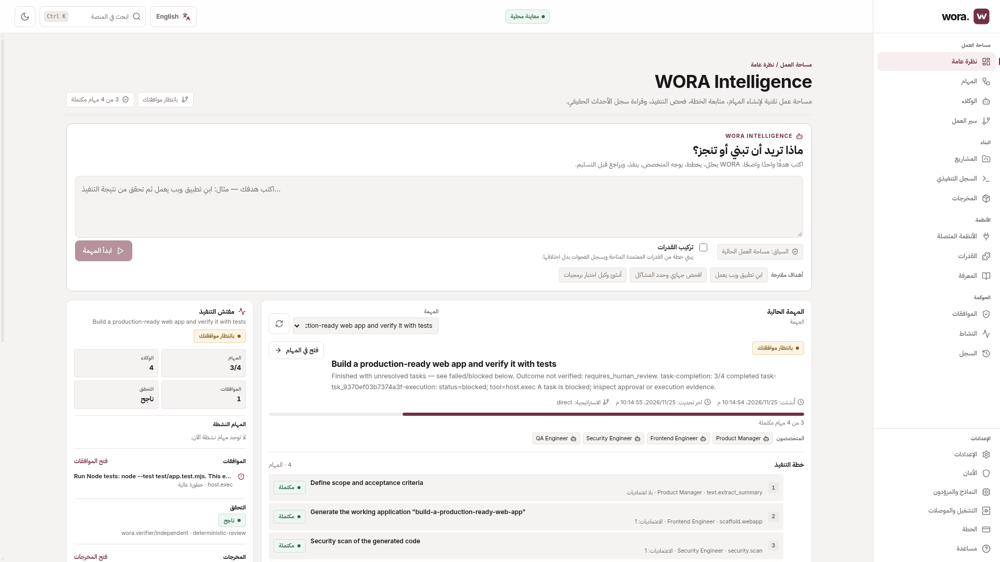

Arabic, dark theme, desktop:

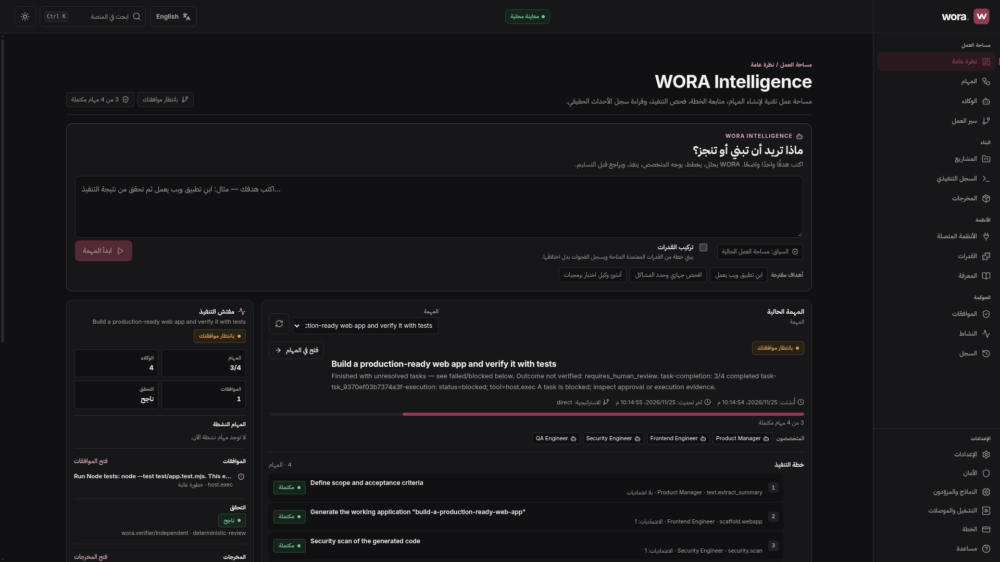

English, light theme, desktop:

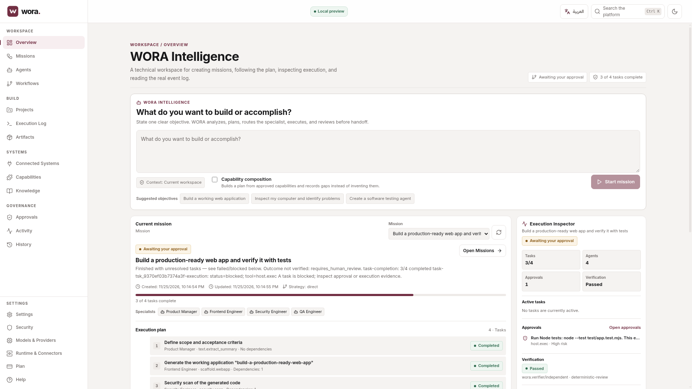

Arabic, light theme, mobile:

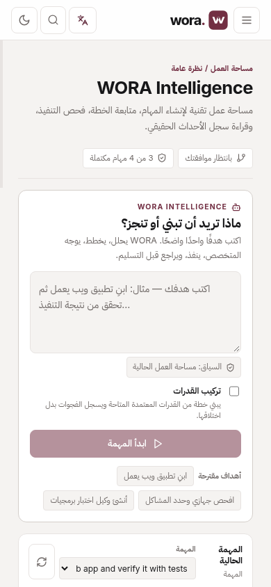

Arabic, dark theme, mobile:

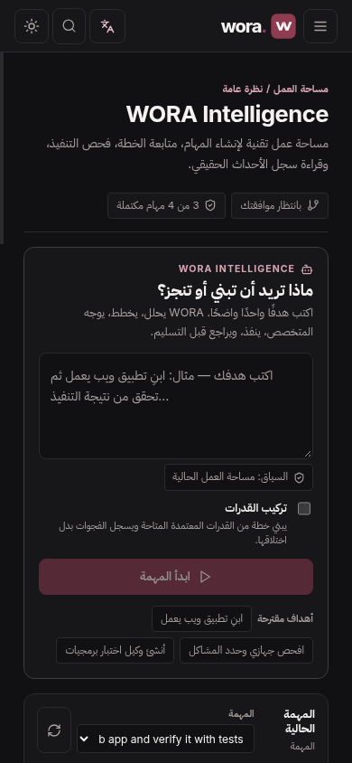

English, light theme, mobile:

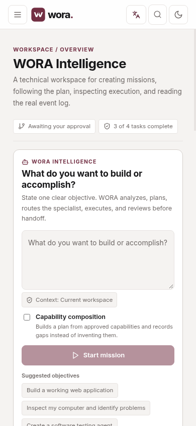

### Execution Inspector

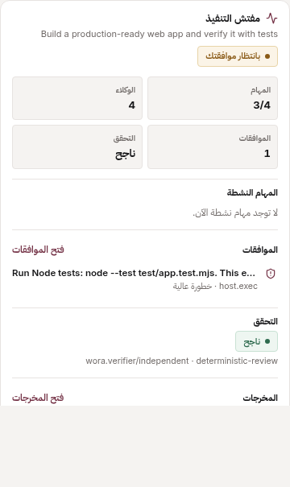

### Workflows

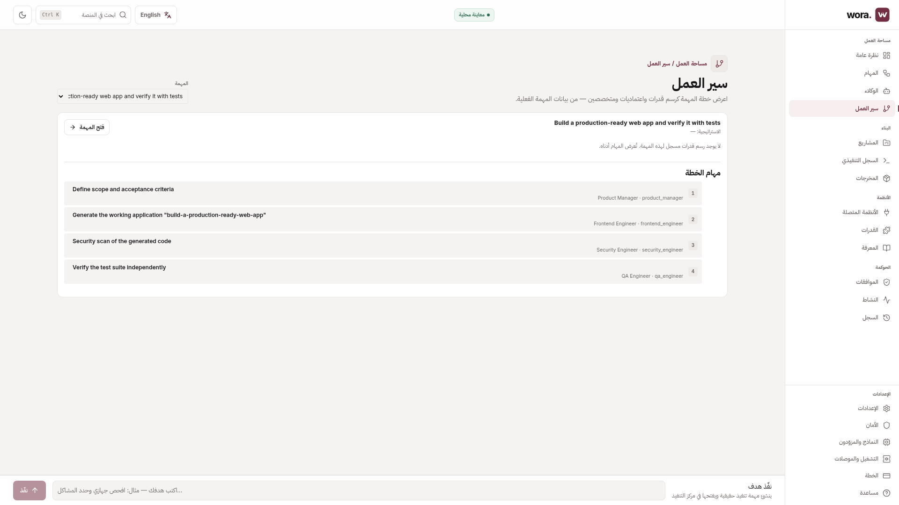

### Terminal / execution log

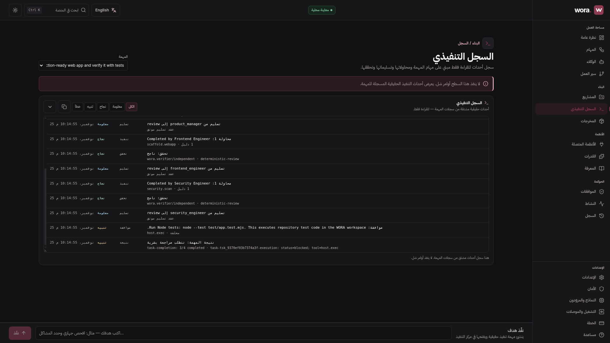

### Approvals

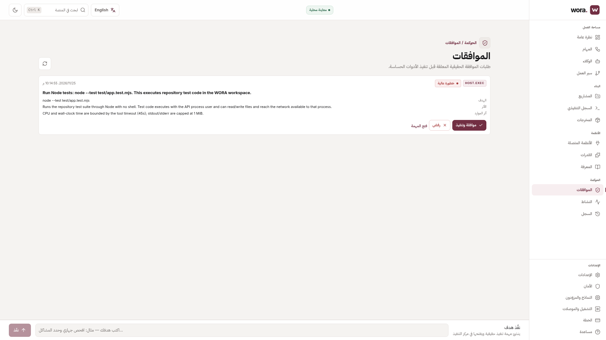

### Extensions

Light theme:

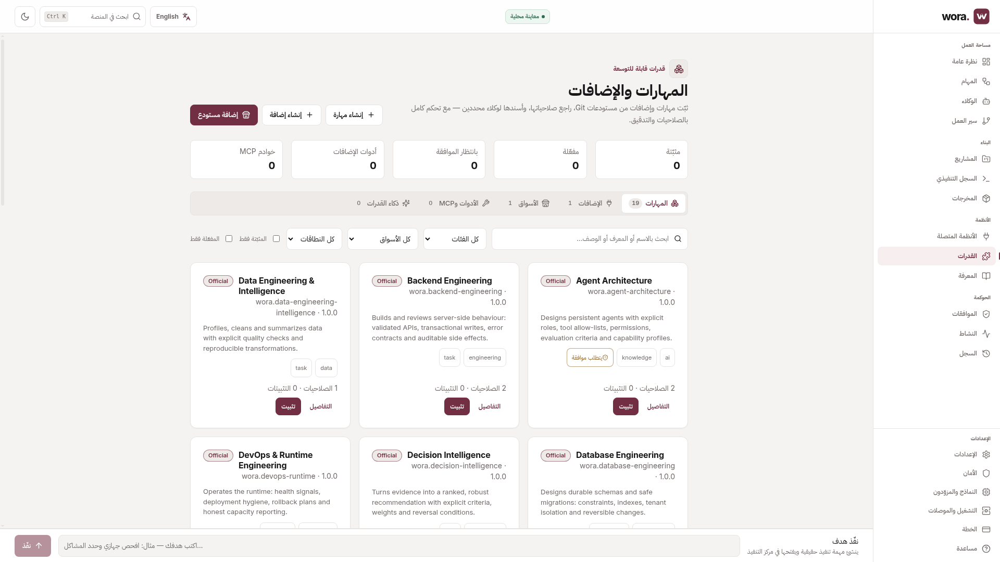

Dark theme:

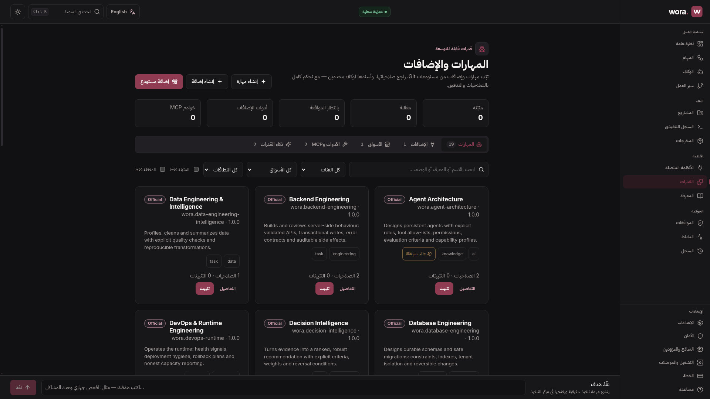

## Verification run on the integration branch

- Client tests: **61 passed, 0 failed**.
- Browser E2E: **1 passed, 0 failed**.
- API tests: **375 passed, 0 failed, 1 skipped** out of 376 (MongoDB test skipped because
  MongoDB is not configured in this environment).
- API and client suites pass on both Node.js 22 and Node.js 24.
- Client typecheck: passed.
- API typecheck: passed.
- Client production build: passed; API/deployment contract check passed;
  Vite transformed 1,721 modules.
- API production build: passed for `index`, `seed`, `issue-session` and
  `os-worker`.
- Browser verification used the integrated branch on port `12001` with the
  integrated API on port `4130`.
- A real mission was created through the integrated UI and reached
  `awaiting_approval` with 3/4 tasks complete, a real approval, verification and
  artifact. The terminal and inspector screenshots are from that mission.

## Known limitations

- Terminal is a read-only mission event log; it does not execute shell commands.
- Mission history "Open" goes to the mission center rather than deep-linking to
  one mission.
- The mission selector truncates very long objectives.
- No visual regression automation; screenshots are captured with CDP.
- The MongoDB test remains skipped without a MongoDB service.
